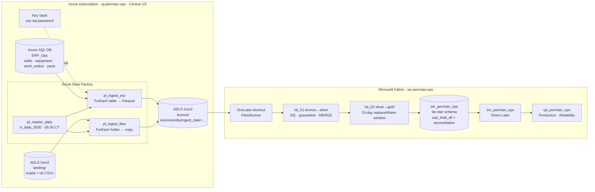
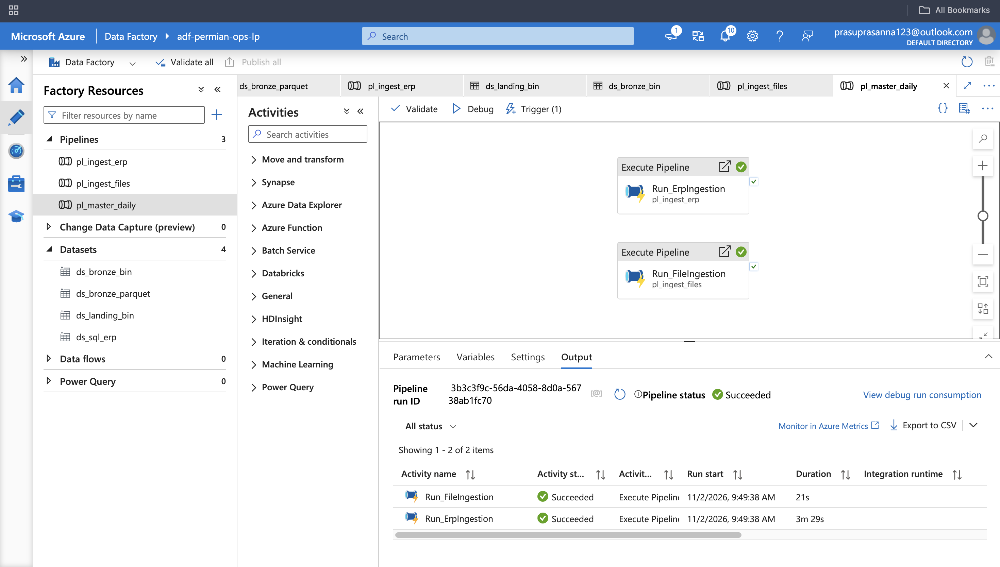
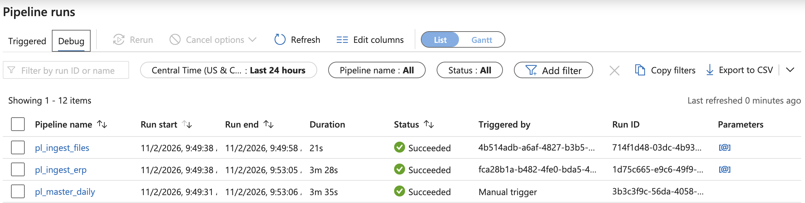
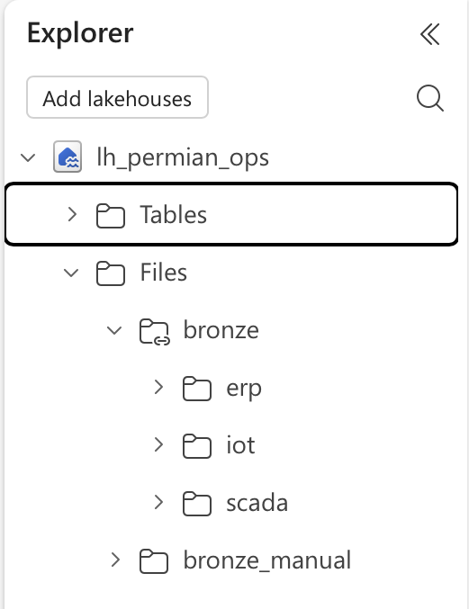
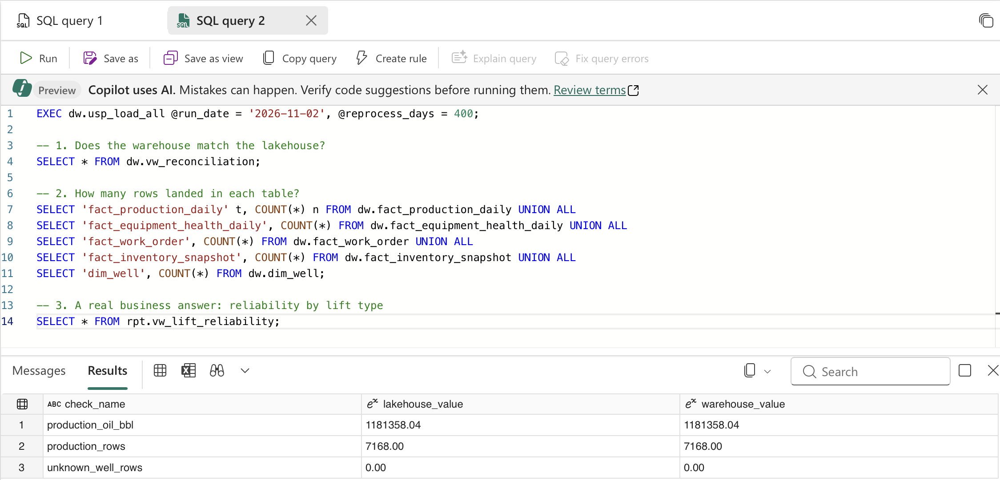
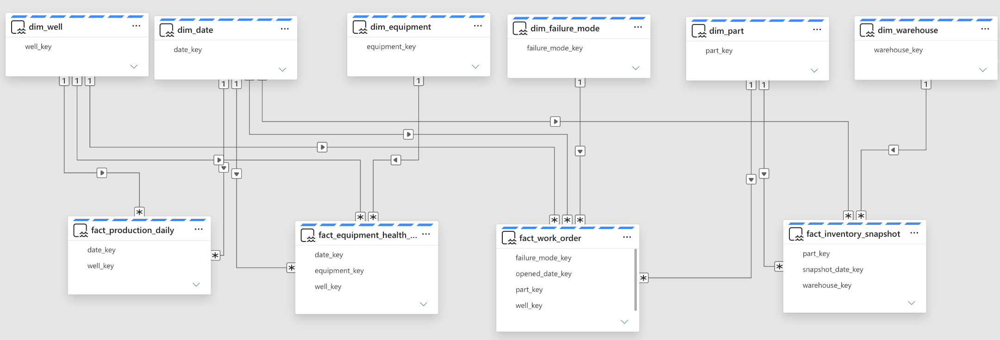
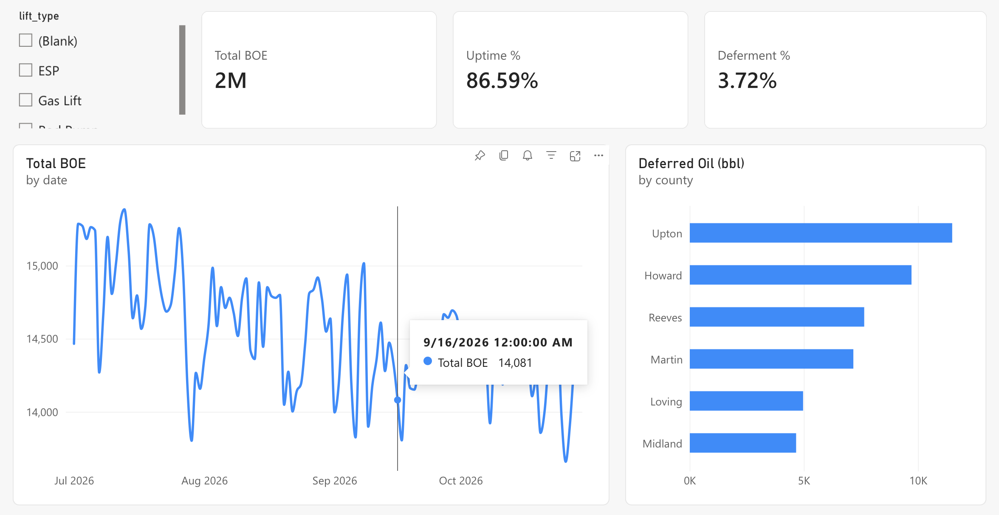
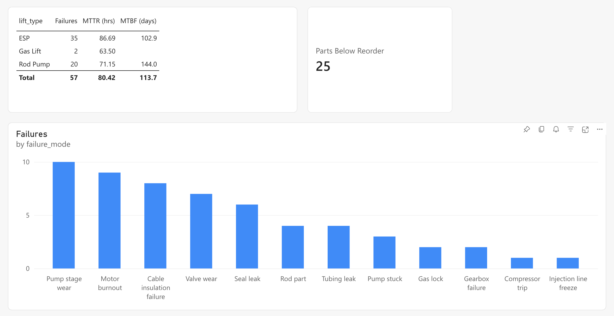
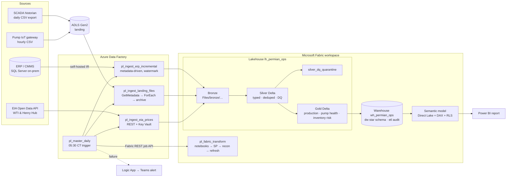

# Permian Basin Operations Analytics
### Microsoft Fabric + Azure Data Factory · medallion lakehouse · star-schema warehouse · Power BI Direct Lake

An end-to-end data platform for an upstream oil & gas operator in the Permian Basin. It brings
together **well production** (SCADA), **artificial-lift pump sensor data** (IoT), **maintenance work
orders and MRO spare-parts inventory** (ERP/CMMS) and **commodity prices** (EIA API) to answer
three business questions:

1. **How much production are we losing, and why?** – deferred barrels and revenue by well, lift type and failure mode.
2. **Which pumps are about to fail?** – daily pump-health score from motor temperature, vibration and amps.
3. **Do we have the parts to fix them?** – days of cover vs. supplier lead time for ESP, rod-lift, valve and instrumentation parts.

---

## What's deployed (as built)

Everything below runs on a free Fabric trial and an Azure free account. **All data is synthetic**, generated by `scripts/generate_sample_data.py`.



- **Cross-tenant bridge.** The Azure subscription and the Fabric workspace sit in different Entra tenants. ADF writes bronze to ADLS Gen2, and Fabric reads it through a **OneLake shortcut**, with no data copied twice.
- **Secrets.** ADF reads the SQL password from Key Vault through its managed identity. The storage key exists only in the Fabric shortcut connection. Neither one is in this repo.
- **Verified end to end.** The silver row counts from the ADF-sourced bronze match the hand-loaded run exactly (7,272 production rows read and 33 quarantined; 155,520 telemetry rows read and 360 quarantined). Warehouse reconciliation: lakehouse = warehouse on oil volume (1,181,358.04 bbl) and row count (7,168), with 0 rows mapped to the unknown well.

### Screenshots
**ADF: `pl_master_daily` runs both ingestion pipelines**


**ADF: monitor, all three pipelines succeeded**

**ADF: master pipeline run (ERP + file ingestion)**


**Lakehouse: `bronze` is a OneLake shortcut to ADLS Gen2**


**Warehouse reconciliation: lakehouse = warehouse**


**Semantic model: 4 facts, 6 conformed dimensions**


**Report: Production**


**Report: Reliability**


## Target architecture (full design)

The repo also contains a fuller production design: an on-prem ERP reached through a self-hosted IR, the EIA price API, ADF triggering the Fabric pipeline through the REST job API, and Teams alerting. These parts are in `adf/` and `fabric/pipeline/` as reference JSON. They were not deployed on the trial.



| Layer | Technology | What happens |
|---|---|---|
| Ingestion | **Azure Data Factory** | Metadata-driven incremental copy from SQL Server (watermarks in `etl.ingestion_control`), file ingestion with archive, REST pagination, Key Vault secrets, retries, audit logging, Teams alert on failure. |
| Orchestration | ADF → **Fabric REST job API** | ADF triggers the Fabric pipeline and polls it (`Until` loop), so one schedule and one alert path cover the whole run. |
| Bronze → Silver | **Fabric notebooks (PySpark)** | Typing, rule-based data quality (`DQRule` framework), quarantine table, de-dup of restatements, Delta `MERGE` upserts, 5 % DQ circuit breaker. |
| Silver → Gold | **Fabric notebooks (PySpark)** | Deferred production vs. 30-day potential, BOE, water cut, GOR, revenue with forward-filled prices, pump health z-scores and `failed_within_7d` label, parts days of cover. Idempotent `replaceWhere` window rebuild. |
| Serving | **Fabric Warehouse (T-SQL)** | Star schema with SCD Type 2 `dim_well`, point-in-time key lookup, transactional fact load, TRY/CATCH + audit, lakehouse↔warehouse reconciliation gate. |
| BI | **Power BI Direct Lake** | Semantic model, 30+ DAX measures (time intelligence, semi-additive inventory, MTBF/MTTR, `USERELATIONSHIP`), RLS by operator. |

## Results on the sample data (120 days, 60 wells)

From `python scripts/run_local_pipeline.py`:

| Metric | Value |
|---|---|
| Rows quarantined by DQ | 34 production rows (negative oil, null well ID) and 360 sensor readings (impossible motor temperature) |
| Duplicate / restated rows resolved | 70 (latest `loaded_at` wins) |
| Oil produced | 1.18 MMbbl (1.75 MMBOE) |
| Deferred oil | 45.7 Mbbl ≈ **$3.1 MM** of deferred revenue |
| Pump-health "Critical" flags followed by a failure within 7 days | **76.6 %** (vs. 2.5 % base rate on "Normal" days) |

## Repository layout

```
adf/                      Azure Data Factory JSON (import via Git integration or ARM)
  linkedService/          Key Vault, ADLS, SQL Server (SHIR), REST, Fabric Lakehouse, Fabric Warehouse
  dataset/                parameterised datasets
  pipeline/               pl_master_daily, pl_ingest_erp_incremental, pl_ingest_landing_files, pl_ingest_eia_prices
  trigger/                daily 05:30 Central schedule
fabric/
  notebooks/lib/transforms.py   pure PySpark transforms + DQ framework (unit tested)
  notebooks/nb_01_bronze_to_silver.py
  notebooks/nb_02_silver_to_gold.py
  pipeline/pl_fabric_transform.json
  warehouse/00_etl_control.sql   control + audit tables, watermark & logging procs
  warehouse/01_star_schema.sql   dims, facts, dim_date, unknown members
  warehouse/02_load_procedures.sql  SCD2 + fact loads + usp_load_all + reconciliation
  warehouse/03_reporting_views.sql
powerbi/                  semantic model design + measures.dax
sql/source_erp/           simulated ERP source DDL
scripts/                  data generator, ERP loader, local end-to-end runner
tests/                    pytest unit tests for the transforms
docs/                     runbook + interview talking points
```

## Run it locally (no Azure needed)

```bash
pip install pandas numpy pyspark==3.5.3 pytest
python scripts/generate_sample_data.py --out data/raw --days 120   # ~11 MB of CSV
pytest -q                                                          # 5 tests
python scripts/run_local_pipeline.py                               # bronze → silver → gold + summary
```

## Deploy to Azure + Fabric

> A Fabric trial capacity (60 days, free) and an Azure free account cover everything here.

1. **Fabric workspace** – create workspace `ws-permian-ops`, a Lakehouse `lh_permian_ops` and a Warehouse `wh_permian_ops`.
2. **Warehouse objects** – run `fabric/warehouse/00` → `03` in the Warehouse SQL editor.
3. **Notebooks** – import `nb_01` and `nb_02` (paste as cells, or `.py` import), attach `lh_permian_ops`
   as default lakehouse, and upload `fabric/notebooks/lib/transforms.py` to each notebook's **Resources**.
4. **Fabric pipeline** – create `pl_fabric_transform` (notebook → notebook → stored procedure → script →
   if-condition → semantic model refresh), matching `fabric/pipeline/pl_fabric_transform.json`.
5. **Source systems** – create an Azure SQL DB `ERP_Ops` (free offer), run `sql/source_erp/01_create_erp_source_tables.sql`,
   then `python scripts/load_erp_source.py --server … --user … --password …`.
   Create an ADLS Gen2 account with a `landing` container and upload `data/raw/daily_production.csv` to
   `landing/scada/daily_production/` and `data/raw/pump_telemetry/*.csv` to `landing/iot/pump_telemetry/`.
6. **Security** – Key Vault with secrets `erp-sql-password`, `fabric-spn-secret`, `eia-api-key`
   (free key from eia.gov/opendata). Give the ADF managed identity *Contributor* on the Fabric workspace
   and *Key Vault Secrets User* on the vault; create a service principal for the Lakehouse/Warehouse linked services.
7. **ADF** – connect the factory to this repo (Git integration, root folder `/adf`), replace the `<placeholders>`,
   add global parameters `FabricWorkspaceId`, `FabricTransformPipelineId`, `AlertLogicAppUrl`, publish,
   and start `tr_daily_0530_ct`. Use a self-hosted IR (`shir-houston-ops`) only for a true on-prem SQL Server;
   with Azure SQL, switch `ls_sqlserver_erp` to `AutoResolveIntegrationRuntime`.
8. **Power BI** – from the Warehouse, create a new semantic model over the `dw` tables, add the relationships
   in `powerbi/semantic_model.md`, paste `powerbi/measures.dax`, and build the report pages.

> The ADF and Fabric JSON were written by hand to match the service schemas. If the ADF Studio import
> flags a property (Fabric connector properties are still evolving), recreate that activity in the UI with the
> same settings; the logic and expressions carry over unchanged.

## Design decisions

- **ADF for ingestion, Fabric for transformation.** ADF's self-hosted IR reaches the on-prem ERP and keeps
  one enterprise schedule and alert path; Fabric does the Spark and SQL work next to OneLake.
- **Metadata-driven ERP extract.** New tables are a row in `etl.ingestion_control`, not a pipeline change.
- **Quarantine, don't drop.** Bad rows are kept with the rule they broke, so the source team can fix them,
  and a >5 % quarantine rate fails the run instead of publishing a misleading report.
- **Idempotent everywhere.** Delta `MERGE`, `replaceWhere` windows and warehouse delete/insert mean any step can be
  re-run after a failure without duplicates.
- **SCD Type 2 on wells.** Operator or lift-type changes don't rewrite history.
- **Reconciliation gate.** The semantic model only refreshes if warehouse totals match the lakehouse.
